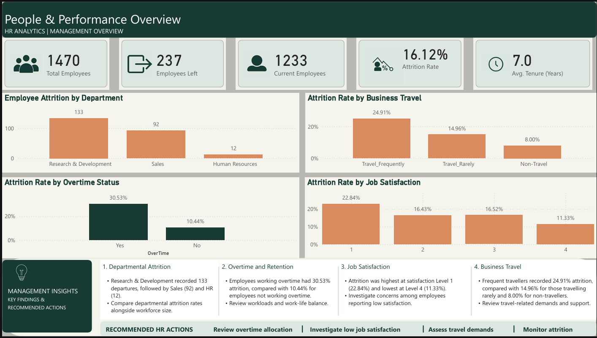
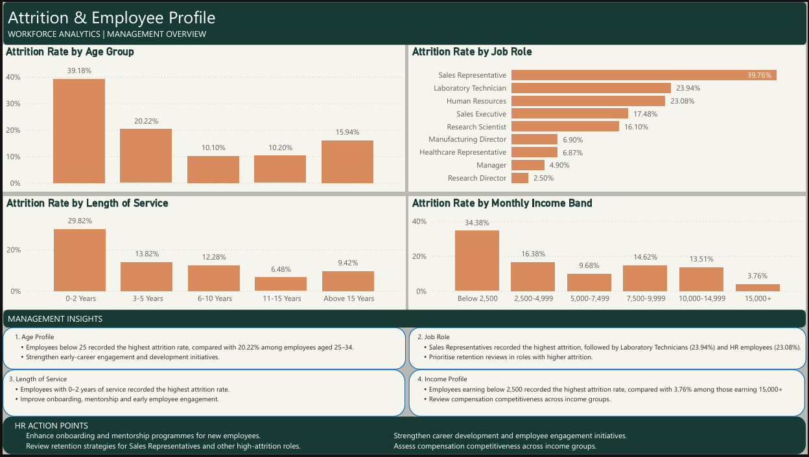
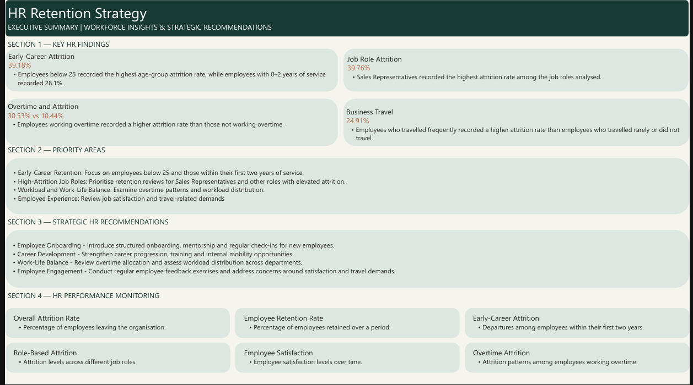

# HR-Analytics-and-Employee-Attrition-Analysis

## Project Overview

This project analyses employee data to identify attrition patterns and examine workforce trends.

## Project Objectives
- Analyse employee attrition.
- Examine attrition across departments and job roles.
- Identify patterns across age groups and length of service.
- Present management insights and recommendations.

## Data Source
The dataset was obtained from Kaggle.

## Tools Used
- Microsoft Power BI
- Power Query
- DAX
- Microsoft Excel

## Project Process
1. Data inspection and preparation.
2. Data cleaning and transformation.
3. Development of calculated measures and KPIs.
4. Dashboard design and visualisation.
5. Analysis of findings and management recommendations.

## Dashboard Previews

### Dashboard 1: Workforce Overview

### Dashboard 2: Employee Demographics

### Dashboard 3: Workforce Analysis

## Key Findings

### 1. Departmental Attrition
The Research and Development department recorded the highest number of employee exits, with 133 employees, followed by Sales with 92 and Human Resources with 12. This indicates that attrition was concentrated more heavily in the Research and Development and Sales departments in terms of employee numbers.

### 2. Business Travel
Employees who travelled frequently recorded the highest attrition rate at 24.91%, compared with 14.96% among employees who travelled rarely and 8.00% among employees who did not travel.

### 3. Overtime and Employee Attrition
Employees who worked overtime recorded an attrition rate of ~31%, compared with ~10% among employees who did not work overtime. This shows a notable difference in attrition rates between the two groups.

### 4. Job Satisfaction
Attrition was highest among employees with a job satisfaction rating of 1 (~23%) and lowest among those with a rating of 4 (~11%). The results show a declining pattern in attrition rates across the satisfaction levels.

### 5. Age Group Analysis
Employees below 25 recorded the highest attrition rate at 39.18%, followed by those aged 25–34 at 20.22%. The 35–44 and 45–54 age groups recorded lower rates of 10.10% and 10.20%, respectively, while employees aged 55 and above recorded 15.94%.

### 6. Attrition by Job Role
Sales Representatives recorded the highest attrition rate at 39.76%, followed by Laboratory Technicians at 23.94% and Human Resources employees at 23.08%. Research Directors and Managers recorded comparatively lower rates of 2.50% and 4.90%, respectively.

### 7. Length of Service
Employees with 0–2 years of service recorded the highest attrition rate at 29.82%. The rate declined to 13.82% among employees with 3–5 years of service and 12.28% among those with 6–10 years of service. Employees with 11–15 years of service recorded the lowest rate at 6.48%.

### 8. Monthly Income
Employees earning below 2,500 recorded the highest attrition rate at 34.38%, followed by those earning between 2,500 and 4,999 at 16.38%. The lowest attrition rate was recorded among employees earning 15,000 and above, at 3.76%.

## Management Recommendations

**1. Strengthen Early-Career Retention**

Review onboarding programmes, mentorship arrangements and career development opportunities to support employees during their early years with the organisation.

**2. Review Workload and Overtime Practices**

Assess overtime schedules, workload distribution and staffing levels to identify areas where adjustments may improve employee retention and workforce sustainability.

**3. Develop Role-Specific Retention Strategies**

Conduct targeted reviews of roles with elevated attrition rates to understand potential challenges relating to workload, career progression, employee engagement and working conditions.

**4. Improve Employee Engagement**

Establish regular employee feedback mechanisms, engagement surveys and structured follow-up processes to better understand employee concerns and improve workplace satisfaction.

**5. Strengthen Workforce Monitoring**

Monitor attrition rates across departments, job roles, age groups and length of service. Regularly review these indicators alongside employee headcount to identify emerging retention patterns and support timely management decisions.

## Conclusion

The HR Analytics project provides an overview of employee attrition patterns across key workforce characteristics, including age, department, job role, length of service, overtime, job satisfaction and monthly income.

The analysis identifies notable attrition patterns among younger employees, employees with shorter periods of service, selected job roles and employees who work overtime. It also highlights differences in attrition across job satisfaction levels and departments.

These findings provide management with a data-driven basis for identifying employee groups and areas that may require further investigation. By reviewing the highlighted patterns, strengthening employee engagement initiatives and assessing existing workforce practices, the organisation can develop more targeted employee retention strategies.

Overall, the project demonstrates how data analysis and Power BI visualisation can support HR reporting, workforce monitoring and informed management decision-making.
